  

# 🎮 Awesome AI Game Agent Development & Modding

  
  
  
  
  
  

## 🌟 Top AI Game Agent Development & Modding Ecosystem

> **A curated showcase of SaaS platforms, frameworks, runtimes, and open-source GitHub projects for autonomous game agents, LLM Minecraft bots (Mineflayer), mod loaders, high-throughput game servers, and modding toolchains.**

**Last updated: November 2026** 📅

---

## 📑 Table of Contents

- [🌐 Sector Overview & Market Dynamics](#-sector-overview--market-dynamics)
- [☁️ SaaS & Hosted Platforms](#️-saas--hosted-platforms)
- [💻 Open-Source GitHub Projects](#-open-source-github-projects)
  - [Top Projects (Ranked by GitHub_Stars)](#top-projects-ranked-by-github-stars)
  - [Recommended Tech Stack Recipes](#recommended-tech-stack-recipes)
- [🤝 How to Contribute](#-how-to-contribute)
- [💖 Support & Sponsorship](#-support--sponsorship)
- [📈 Star History](#-star-history)
- [📜 Disclaimer](#-disclaimer)

---

## 🌐 Sector Overview & Market Dynamics

The global AI in gaming and embodied virtual agent market is estimated at approximately **$3.5B to $4.2B** (projected to reach over **$15B by 2030** at a **~25% CAGR**). 

The sector remains **moderately fragmented**: core developer runtimes, pathfinding engines, and NPC tools coexist across specialized generative AI agent startups and traditional game-modding distribution networks, while infrastructure and platform layers are actively contested by major game engine providers, cloud hosts, and venture-backed platforms.

---

## ☁️ SaaS & Hosted Platforms

| Platform | Valuation / Revenue Scale | Pricing (Starting Tier) | Free Tier Limits | Description |
| :--- | :--- | :--- | :--- | :--- |
| **[Inworld AI](https://inworld.ai)** | **$500M+ valuation** (~$107M–$150M+ raised) | $25/month (Creator Tier) | **70 mins/mo free TTS**, 400 mins/mo free STT, 2,000 char TTS playground limit, 5 concurrent requests, up to 20 estimated concurrent sessions (On-Demand free plan). | Cloud AI character engine & SDK enabling contextual, memory-backed, voice-capable autonomous NPCs across Unity, Unreal Engine, and web runtimes. |
| **[Overwolf](https://overwolf.com)** | **$250M–$500M valuation** (~$150M raised, $300M+ paid out to creators) | $2.50/month (CurseForge ad-free subscription) | **Full access free forever** to overlay apps, mod management, and mod downloads supported by banner/video ads. | Commercial desktop overlay, game app framework, and mod distribution ecosystem powering the CurseForge app and game telemetry integrations. |
| **[CurseForge](https://curseforge.com)** | **Subsidiary of Overwolf** (Acquired for ~$10M–$15M; ecosystem processes $300M+ creator payouts) | $2.50/month (CurseForge Premium) | **Full mod browsing, auto-installation, and updates free forever** with ad-supported interface in app and web. | Commercial cloud mod repository and modpack distribution platform spanning Minecraft, World of Warcraft, and PC titles. |
| **[Apex Hosting](https://apexminecrafthosting.com)** | **$40M+ annual revenue** (Acquired by Nitrado / marbis GmbH under Flex Capital) | $9.99/month ($7.49 first month for 2 GB basic plan) | **7-day money-back guarantee** (no permanent free tier; paid hosting infrastructure). | Enterprise game server hosting provider offering one-click Fabric, PaperMC, Spigot, and modpack deployments for multi-agent bot environments. |
| **[Convai](https://convai.com)** | **~$6.5M annual revenue** (Venture-backed by Rainfall Ventures & Mountain View Capital) | $29/month ($22/mo billed annually for Indie Dev) | **100 interactions/month**, 60 mins Cloud Rendered Avatar Studio & Convai Sim, and 1 character session concurrency free forever. | Cloud conversational AI and spatial reasoning platform enabling NPCs to perceive 3D environments, navigate scenes, and interact with players. |
| **[Altera / Project Sid](https://altera.al)** | **$11.1M total funding** ($9M Seed led by Patron & First Spark Ventures; ~$40M estimated seed valuation) | Developer / Research API access (waitlist / pilot pricing) | **Free open-source research access** to papers/benchmarks and closed beta companion waitlist access. | Cloud autonomous AI agent civilization platform running multi-agent LLM simulations inside persistent Minecraft worlds with emergent economic behavior. |
| **[Modrinth](https://modrinth.com)** | **$1.2M seed funding** (Acquired by Spark Universe in 2026; Adrinth monetization) | $4.99/month (Modrinth+ ad-free / cosmetic tier; Modrinth server hosting starts at $5/mo) | **Unlimited free downloads, modpack creation, and mod hosting forever** (funded via Adrinth advertisements). | Modern, developer-friendly open platform for hosting, discovering, monetizing, and distributing Minecraft mods and modpacks via REST API. |
| **[exaroton](https://exaroton.com)** | **Bootstrapped / Profitable SME** (Operated by Aternos GmbH) | €0.01 per GB RAM/hour (~€7.20/mo for 1 GB continuous 24/7) | **5 free credits (€0.05 value)** on signup to test servers without a credit card; sister service **Aternos** provides 100% free ad-supported servers (dynamic 2–4 GB RAM, 4 GB storage cap, queue-based startup, auto-sleep). | Pay-per-minute cloud Minecraft server platform with fast sleep/wake automation and custom modpack/bot support. |
| **[MCreator / Pylo](https://mcreator.net)** | **Independent / Bootstrapped SME** (Pylo UG; community-funded) | €10/month (Patreon Supporter Tier for priority builds) | **100% free and open-source software (GPL v3)** with unlimited local mod and datapack generation; optional community cloud showcase. | Visual mod-creation and prototyping IDE enabling developers to build custom entities, behaviors, blocks, and dimensions without deep Java boilerplate. |

---

## 💻 Open-Source GitHub Projects

### Top Projects (Ranked by GitHub_Stars)

The following repositories form the bedrock of AI game agent development, modding toolchains, simulation benchmarks, and high-performance server architectures. Repositories are ranked in descending order by GitHub stargazers count:

1. **[Godot Engine](https://github.com/godotengine/godot)**  🎮  
   *Feature-packed, multi-platform 2D and 3D open-source game engine (`MIT`). Prized for its lightweight architecture, Python-like GDScript, C# support, and rapid integration with local AI agents, LLM copilot plugins, and reinforcement learning environments.*

2. **[Bevy Engine](https://github.com/bevyengine/bevy)**  🦀  
   *A refreshingly simple, data-driven game engine built in Rust (`MIT` / `Apache-2.0`). Features an ultra-fast Entity Component System (ECS) ideally suited for highly concurrent, memory-safe multi-agent simulation and AI systems.*

3. **[Unity ML-Agents Toolkit](https://github.com/Unity-Technologies/ml-agents)**  🧠  
   *Open-source toolkit (`Apache-2.0`) enabling games and simulations built with Unity to serve as environments for training intelligent agents via deep reinforcement learning, imitation learning, and evolutionary algorithms with Python PyTorch bindings.*

4. **[Farama Gymnasium](https://github.com/Farama-Foundation/Gymnasium)**  🏋️  
   *The standard open-source (`MIT`) Python interface for single-agent reinforcement learning environments (maintained fork of OpenAI Gym). Foundation for benchmarking game-playing AI agents across classic, arcade, and 3D simulation domains.*

5. **[PaperMC Paper](https://github.com/PaperMC/Paper)**  📜  
   *High-performance open-source (`GPL-3.0`) Minecraft server software forked from Spigot. Features asynchronous chunk loading, optimized tick loops, anti-exploit protections, and full Bukkit/Spigot/Paper plugin support for hosting AI agent sandboxes.*

6. **[Prism Launcher](https://github.com/PrismLauncher/PrismLauncher)**  💎  
   *Custom open-source (`GPL-3.0`) Minecraft launcher with isolated instance management, native Modrinth and CurseForge modpack integration, and multi-Java runtime handling across Linux, Windows, and macOS.*

7. **[Baritone](https://github.com/cabaletta/baritone)**  🧭  
   *Ultra-fast, deterministic pathfinding and world-traversal bot system written in Java (`LGPL-3.0`). Employs modified A* search algorithms to navigate, break, place, and mine blocks; frequently utilized as the movement backbone for higher-level AI agents.*

8. **[Mineflayer](https://github.com/PrismarineJS/mineflayer)**  🤖  
   *Foundational open-source (`MIT`) JavaScript and TypeScript library for building headless, programmable Minecraft bots. Provides comprehensive abstractions for inventory management, crafting, physics, entity tracking, combat, and block interactions.*

9. **[Voyager](https://github.com/MineDojo/Voyager)**  🚀  
   *Landmark open-source (`MIT`) embodied lifelong learning agent powered by GPT-4 in Minecraft. Continuously explores the world, autonomously writes, debugs, and stores Mineflayer JavaScript skills in a vector library, and accomplishes complex milestones without human intervention.*

10. **[Mindcraft](https://github.com/mindcraft-bots/mindcraft)**  💬  
    *Collaborative open-source (`MIT`) LLM-driven Minecraft agent framework powered by Mineflayer. Connects to OpenAI, Anthropic Claude, Google Gemini, and local Ollama models with persistent memory and interactive voice/chat dialogues.*

11. **[Geyser](https://github.com/GeyserMC/Geyser)**  🌉  
    *A bridge proxy enabling Bedrock edition clients and mobile/cross-platform agents to seamlessly connect to Minecraft Java edition servers (`CC0-1.0`). Essential for multi-platform game agent deployments.*

12. **[PaperMC Folia](https://github.com/PaperMC/Folia)**  ⚡  
    *A modernized fork of PaperMC (`GPL-3.0`) that adds regionized multithreading to Minecraft. Allows separate world areas to run independently in parallel threads, unlocking massively scaled multiplayer worlds and thousands of simultaneous AI bot agents.*

13. **[Project Malmo](https://github.com/microsoft/malmo)**  🔬  
    *Pioneering open-source (`MIT`) AI experimentation platform developed by Microsoft Research. Built on Minecraft modding hooks to support deep reinforcement learning, computer vision, and cognitive research.*

14. **[Farama PettingZoo](https://github.com/Farama-Foundation/PettingZoo)**  🐾  
    *Multi-agent reinforcement learning (MARL) standard interface (`MIT`) from Farama Foundation (the multi-agent equivalent of Gymnasium). Facilitates competitive, cooperative, and mixed agent experiments.*

15. **[FabricMC](https://github.com/FabricMC/fabric)**  🧵  
    *Lightweight, highly modular Minecraft modding toolchain and loader (`Apache-2.0`). Prized for near-instant snapshot releases, clean Mixin bytecode manipulation, and client/server-side agent instrumentation.*

16. **[Modrinth App / Theseus](https://github.com/modrinth/code)**  📦  
    *Unified open-source monorepo (`GPL-3.0`) containing the frontend, high-performance Rust desktop launcher, and microservices for the Modrinth modding ecosystem.*

17. **[Purpur](https://github.com/PurpurMC/Purpur)**  🔮  
    *Drop-in replacement for PaperMC (`MIT`) designed for extreme gameplay configurability, custom entity mob attributes, and optimized performance for high-density bot simulations.*

18. **[PaperMC Velocity](https://github.com/PaperMC/Velocity)**  🚀  
    *Next-generation, high-performance Minecraft proxy server (`GPL-3.0`) designed to route players and autonomous bots across clusters of backend server instances with optimal throughput.*

19. **[MineDojo](https://github.com/MineDojo/MineDojo)**  🥋  
    *Award-winning embodied AI research suite (`MIT`) built on Minecraft. Features thousands of benchmark tasks, extensive multimodal internet knowledge bases (YouTube, Wiki, Reddit), and MineCLIP pretrained vision-language models.*

20. **[NeoForge](https://github.com/neoforged/NeoForge)**  🔨  
    *Community-driven fork of Minecraft Forge (`LGPL-2.1`) providing a modernized, highly compatible modding API, event pipeline, and tooling for large-scale content and gameplay modification.*

21. **[Ferium](https://github.com/gorilla-devs/ferium)**  ⚡  
    *Fast, multi-threaded CLI mod manager written in Rust (`GPL-3.0`). Automatically resolves, verifies, and downloads mods from Modrinth, CurseForge, and GitHub Releases.*

22. **[blendi-remade/agentcraft](https://github.com/blendi-remade/agentcraft)**  🛡️  
    *Open-source AI game agent and Minecraft automation framework designed for embodied LLM agents to perceive game state, execute complex actions, and collaborate inside sandboxed worlds.*

23. **[Packwiz](https://github.com/packwiz/packwiz)**  📋  
    *Command-line tool (`MIT`) for creating and managing Minecraft modpacks using declarative TOML metadata and Git version control with native Modrinth export support.*

24. **[MineRL](https://github.com/minerllabs/minerl)**  ⛏️  
    *Reinforcement learning dataset and simulator platform for sample-efficient embodied agent learning in Minecraft (`MIT`). Host of the prestigious NeurIPS MineRL competition series.*

25. **[MCProtocolLib](https://github.com/GeyserMC/MCProtocolLib)**  📡  
    *Simple, low-level Java library (`MIT`) facilitating the sending and receiving of Minecraft protocol packets for building custom bot clients and lightweight automated proxies.*

26. **[ATLauncher](https://github.com/ATLauncher/ATLauncher)**  🚀  
    *Established open-source (`GPL-3.0`) multi-platform launcher supporting Modrinth, CurseForge, and Technic modpacks with integrated server-creation tools.*

27. **[Azalea](https://github.com/azalea-rs/azalea)**  🌸  
    *High-performance, async Minecraft bot library written in Rust (`MIT` / `Apache-2.0`). Designed for extreme concurrency, deterministic physics simulation, and low memory footprint.*

28. **[mineflayer-pathfinder](https://github.com/PrismarineJS/mineflayer-pathfinder)**  🗺️  
    *Configurable 3D A* pathfinding plugin for Mineflayer (`MIT`). Enables bots to navigate arbitrary terrain, place bridging blocks, dig obstacles, avoid hazards, and chase dynamic entities.*

---

### Recommended Tech Stack Recipes

- **🤖 Embodied LLM Agent Loop**: Combine **Mineflayer** + **Voyager / Mindcraft** + **Ollama** (or Claude/GPT APIs) for cognitive decision-making and self-improving skill acquisition.
- **⚡ High-Throughput Agent Testing**: Deploy **PaperMC Folia** or **Purpur** behind a **Velocity** proxy for running hundreds of concurrent bot agents without physics lag.
- **🧪 Modded Client Instrumentation**: Use **FabricMC** + **Packwiz** + **Prism Launcher** for declarative modpack provisioning and automated environment reproduction.
- **🧠 Formal RL & MARL Benchmarking**: Couple **MineDojo / MineRL** or **Unity ML-Agents** with **Gymnasium** and **PettingZoo** for deep reinforcement learning curricula.

---

## 🤝 How to Contribute

Contributions are welcome to keep this ecosystem comprehensive, accurate, and up-to-date!

1. 🍴 **Fork** the repository.
2. 🌿 Create your feature branch (`git checkout -b feature/new-game-ai-tool`).
3. ✏️ Add or update entries following the formatting conventions (name, Stars_Badge, link, concise description).
4. 📬 Submit a **Pull Request** with a brief summary of what you added and why.

---

## 💖 Support & Sponsorship

If you find this curated ecosystem helpful for your AI research, game agent engineering, or modding projects:

- ⭐ **Star this repository** to help others discover it!
- 🍴 **Fork and share** it with your developer community.
- ☕ **Buy a coffee & sponsor**: Support continuous maintenance via the [GitHub Sponsor Dashboard](https://github.com/sponsors/ishandutta2007).

---

## 📈 Star History

---

## 📜 Disclaimer

This repository is an independently curated educational and community resource. All product names, logos, trademarks, and registered trademarks belong to their respective owners. Mention of tools does not constitute commercial endorsement.
